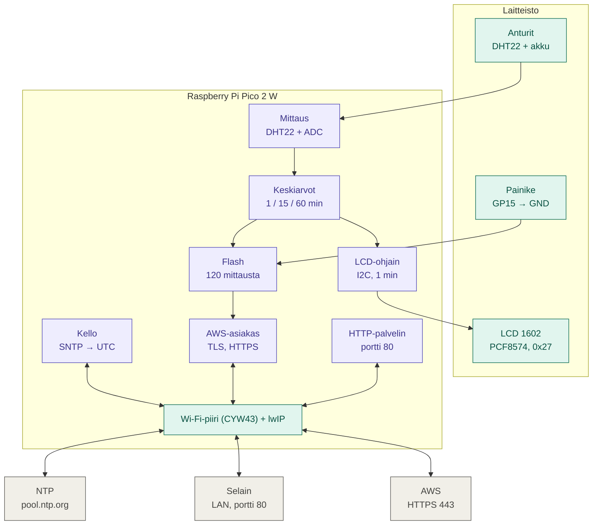
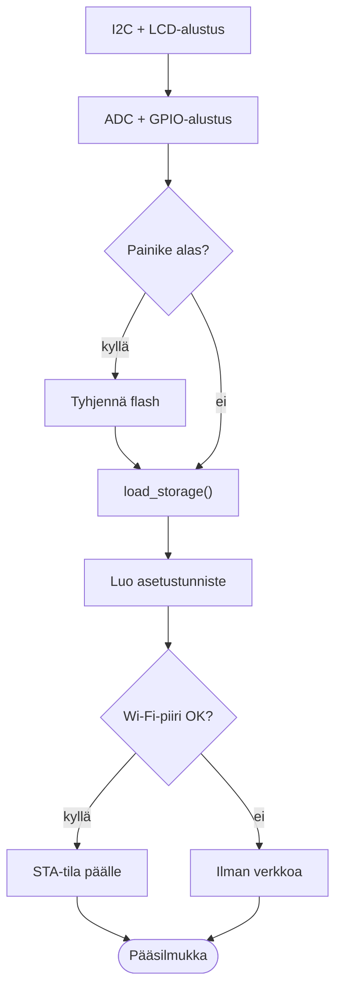
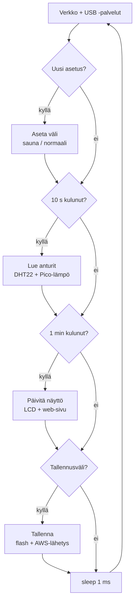
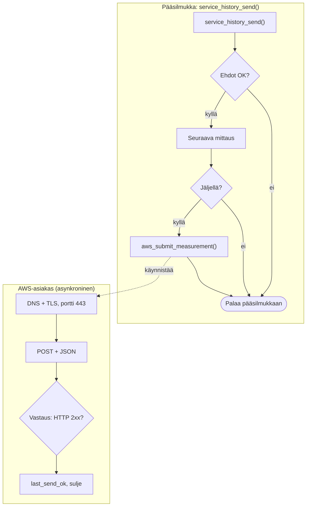
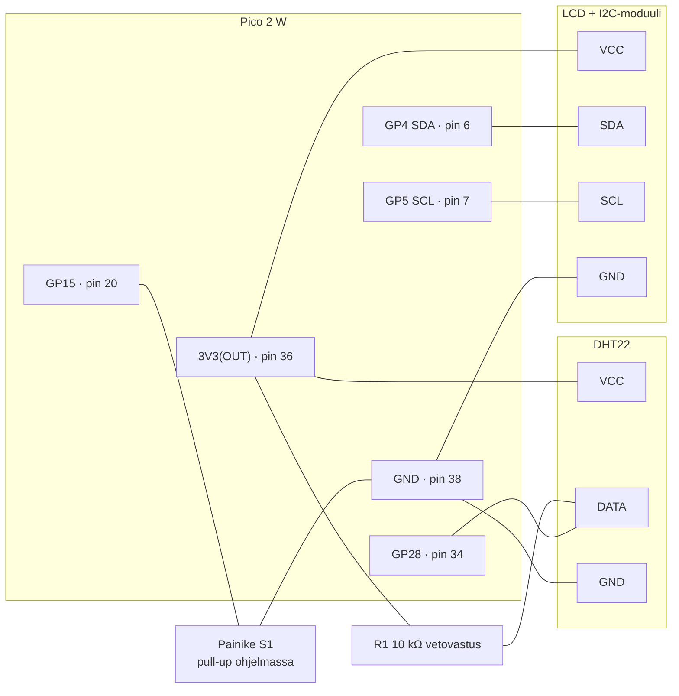
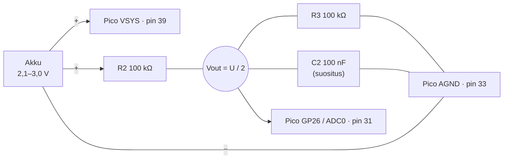

# Pico 2 W -sääasema: käyttöohje

---

## A1. Mitä laite tekee

Laite mittaa lämpötilaa ja ilmankosteutta DHT22-anturilla 10 sekunnin välein. Se laskee mittauksista keskiarvon ja näyttää sen LCD-näytöllä minuutin välein. Valituin väliajoin (oletus 15 min) se tallentaa keskiarvon omaan muistiinsa ja lähettää mittaukset Wi-Fi-verkon kautta pilvipalvelimelle (AWS). Jos verkko katkeaa, mittaus jatkuu ja tiedot lähetetään myöhemmin.

## A2. LCD-näyttö

Näyttö päivittyy kerran minuutissa.

| Rivi | Sisältö |
|---|---|
| 1 | Lämpömittarin kuvake, lämpötila (°C), pisaran kuvake, ilmankosteus (%) |
| 2 | Pariston kuvake, akun varaus (%), (S:) ja laitteen oma sisälämpötila (°C) |

Erikoistilanteet:

- **Pico saa-asema / Käynnistyy…** laite on juuri käynnistynyt.
- **Odotetaan mittauksia…** ensimmäistä minuuttikeskiarvoa ei ole vielä laskettu.
- **Anturivirhe / Ei mittauksia** viimeisen minuutin aikana ei saatu yhtään kelvollista mittausta DHT22-anturilta.

Akun varaus on arvio jännitteestä: 2,1 V on 0 % ja 3,0 V on 100 %. Arvio on viitteellinen.

## A3. Web-sivu

Kun laite on yhteydessä Wi-Fi-verkkoon, sen tilasivu aukeaa selaimella saman verkon laitteilta osoitteesta `http://<laitteen IP>/`. IP-osoite näkyy sarjaporttiloki-rivillä `Wi-Fi yhdistetty. IP: …`. Reitittimen laiteluettelosta sen löytää myös.

Sivu näyttää:

- viimeisen minuutin keskiarvon (lämpötila, kosteus, sisälämpötila, akku) ja mittausajan
- tallennettujen mittausten määrän (`Historiassa: n/120`)
- nykyisen tallennusvälin ja jäljellä olevan ajan seuraavaan tallennukseen

Sivu päivittyy itsestään 10 sekunnin välein. Päivitys pysähtyy, kun valitset asetuskentän, jotta valinta ei katoa kesken valinnan.

## A4. Tallennusvälin vaihto

Sivun lomakkeella voi valita:

| Valinta | Vaikutus |
|---|---|
| 15 minuuttia | Oletus. Tallennus ja AWS-lähetys 15 min välein. |
| 60 minuuttia | Harvempi tallennus ja lähetys. |
| Sauna-mode (1 min) | Tallennus minuutin välein, mutta Wi-Fi katkaistaan eikä mitään lähetetä AWS:ään. |

Paina **Ota käyttöön**. Uusi jakso alkaa heti, ja keskeneräisen jakson keskiarvo nollataan.

### Sauna-mode

Sauna-mode on tarkoitettu tilanteisiin, joissa laite on kuumassa ja verkkoyhteyttä ei tarvita. Muisti täyttyy nopeasti: 120 mittausta on minuutin välillä vain 2 tuntia. Sauna-moden aikana web-sivu ei ole käytettävissä, koska Wi-Fi on pois päältä.

Sauna-modesta palataan normaaliin tilaan käynnistämällä laite uudelleen (oletus on aina 15 min). Mittausten mukaan laite on palautunut sauna-modesta ongelmitta. Historia lähetetään AWS:ään uudelleen, kun Wi-Fi on takaisin.

## A5. Mittausmuisti ja historia

- Laite tallentaa enintään **120 mittausta**. Kun muisti täyttyy, vanhin mittaus poistuu.
- Historian pituus: 1 min tallennusvälillä noin 2 tuntia, 15 min välillä noin 30 tuntia ja 60 min välillä noin 5 vuorokautta.
- Muisti säilyy, kun virta katkeaa.
- Tallennetut mittaukset tulostuvat USB-sarjaportille, kun avaat sarjaporttimonitorin.

## A6. Muistin tyhjennys

Vedä pinni 20 (GP15) maihin ja kytke virta. Käynnistyksessä laite tyhjentää mittausmuistin ja näyttää hetken tekstin **Muisti tyhjennetty**. Tämä poistaa kaikki tallennetut mittaukset.

## A7. Paristot

Laite jatkaa toimintaa, kunnes paristot loppuvat. Akun varaus näkyy LCD:llä ja web-sivulla. Vaihda paristot, kun varaus on lähellä nollaa. Muisti säilyy vaihdon yli. Aika haetaan uudelleen verkosta, kun Wi-Fi on käytettävissä.

## A8. Käyttöönotto

Ennen ohjelman asennusta täytetään kaksi asetustiedostoa. Tiedostot sijaitsevat projektin lähdekoodikansiossa.

### 1. Wi-Fi-asetukset: `wifi_settings.h`

```c
#ifndef WIFI_SETTINGS_H
#define WIFI_SETTINGS_H

// Wi-Fi-tunnukset. Vaihda nämä oman verkkosi mukaan.
#define WIFI_SSID     "verkon_nimi"
#define WIFI_PASSWORD "verkon_salasana"

#endif
```

### 2. AWS-asetukset: `aws_settings.h`

```c
#ifndef AWS_SETTINGS_H
#define AWS_SETTINGS_H

#define AWS_HOST          "aws_host"
#define AWS_PATH          "/measurement/save"
#define AWS_AUTHORIZATION "authorization_avain"
#define AWS_SENSOR_ID     "anturin_tunniste"
#define AWS_SENSOR_NAME   "anturin_nimi"

#endif
```

| Vakio | Merkitys |
|---|---|
| `WIFI_SSID` | Wi-Fi-verkon nimi |
| `WIFI_PASSWORD` | Wi-Fi-verkon salasana |
| `AWS_HOST` | Palvelimen osoite |
| `AWS_PATH` | Pyynnön polku palvelimella |
| `AWS_AUTHORIZATION` | Palvelimelta saatu avain. Lähetys ei käynnisty, jos arvoa ei ole täytetty. |
| `AWS_SENSOR_ID` | Anturin yksilöivä tunniste |
| `AWS_SENSOR_NAME` | Anturin nimi, joka näkyy palvelimella |

> Tunnisteet eivät saa sisältää lainausmerkkejä, kenoviivoja tai ohjausmerkkejä.

> **Tietoturva.** Tiedostot sisältävät salasanan ja avaimen. Älä lisää niitä versionhallintaan (esimerkiksi lisää ne `.gitignore`-tiedostoon) äläkä jaa niitä muille.

-----------------------------------------------------------------------------------

# Pico 2 W -sääasema: testausraportti

Päiväys: xx.xx.2026
Testaaja: Petri Markkanen

## 1. Yhteenveto

Järjestelmää on testattu pääasiassa pitkäaikaisella kenttäajolla. Mittausminuutteja on kertynyt yli 20 000 (noin 13,9 vuorokautta). Testijakson aikana on kokeiltu verkkokatkoa ja sauna-modea, eikä järjestelmä ole kaatunut. Ainoa havaittu pysähtymisen syy on ollut paristojen loppuminen.

Koodille ei ole automaattisia yksikkötestejä, koska ohjelma on tiiviisti sidottu laitteistoon (DHT22, LCD, ADC, flash, Wi-Fi). Siksi testaus on tehty itse laitteella. Tämän raportin tulokset ovat testaajan havaintoja.

## 2. Testattava järjestelmä

| Kohde | Tieto |
|---|---|
| Laite | Raspberry Pi Pico 2 W |
| Anturi | DHT22 / AM2302, GP28 |
| Näyttö | LCD 1602 + I2C (0x27), GP4/GP5 |
| Virtalähde | Paristot (2 × AA), akun mittaus GP26 |
| Verkko | Wi-Fi, SNTP (`pool.ntp.org`), HTTPS AWS:ään |
| Näytteenotto | 10 s, näyttö 1 min, tallennus 15 / 60 min (sauna-mode 1 min) |
| Muisti | Flash, 120 mittausta |

## 3. Testausmenetelmä

- **Pitkäaikaiskäyttö:** laite on ollut jatkuvassa käytössä ja havainnot on kerätty laitteen lokista ja käytöstä.
- **Vikatilanteet:** verkkokatko, sauna-mode ja akun loppuminen on koettu käytännössä.
- **Havaintojen lähde:** USB-sarjaporttiloki, LCD ja web-sivu.
- **Hyväksymiskriteeri:** laite ei kaadu eikä jumiudu ja mittaus jatkuu kaikissa tilanteissa.

## 4. Testitapaukset ja tulokset

Tulokset: **Läpäisty**, **Kokeiltu** (tulos kirjattava tarkemmin), **Ei testattu**.

| ID | Testitapaus | Odotettu tulos | Tulos | Huomiot |
|---|---|---|---|---|
| T1 | Pitkäaikaiskäyttö | Laite toimii ilman kaatumisia | **Läpäisty** | Yli 20 000 mittausminuuttia (noin 13,9 vrk). Ei kaatumisia. |
| T2 | Verkkokatko | Mittaus jatkuu paikallisesti, Wi-Fi yhdistyy uudelleen | **Läpäisty** | Verkko on ollut alhaalla eikä laite ole kaatunut. Historian lähetyksen jatkuminen yhteyden palattua: **Läpäisty** |
| T3 | Sauna-mode: käynnistys ja paluu | Tallennus 1 min välein, Wi-Fi pois, paluu normaaliin | **Läpäisty** | Laite on palautunut sauna-modesta. Palautumistapa: **Läpäisty** |
| T4 | Akun loppuminen | Laite sammuu hallitusti, muisti säilyy | **Kokeiltu** | Laite on pysähtynyt vain paristojen loppuessa. Toiminta-aika: `[täydennä]`. Muistin säilyminen ja käynnistys uusilla paristoilla: **Läpäisty**. |
| T5 | Virran katkaisu ja uudelleenkäynnistys | Historia latautuu flashista, minuuttilaskuri jatkuu | **Läpäisty** |
| T6 | SNTP-synkronointi | Aika haetaan, aikaleimat oikein (EET/EEST) | **Läpäisty** |
| T7 | AWS-lähetys | Palvelin vastaa 2xx, mittaukset tallentuvat | **Läpäisty** | Duplikaattien käsittely aws:n päässä | **Läpäisty** |
| T8 | DHT22 irti tai vikaantunut | Lokiin virhe, LCD "Anturivirhe", ei kaatumista | **Ei testattu** |
| T9 | LCD irti | Ohjelma jatkuu ilman näyttöä | **Ei testattu** |
| T10 | Muisti täynnä (120) | Vanhin mittaus poistuu, uusin tallentuu | **Läpäisty** |
| T11 | Muistin tyhjennys painikkeella | Käynnistyksessä muisti tyhjenee | **Läpäisty** |
| T12 | Mittaustarkkuus | Poikkeama vertailumittariin sovitun rajan sisällä | **Läpäisty** | Korjaukset nyt −0,5 °C ja −4 %-yks. Verrattu Forecan tietoihin sekä Home Assistantin antureihin |
| T13| Akun varausarvion tarkkuus | Näytetty % vastaa mitattua jännitettä | **Läpäisty** | Hyvin lähelle ainakin menee. |

## 6. Johtopäätökset

Järjestelmä on osoittautunut luotettavaksi pitkäaikaisessa käytössä: yli 20 000 mittausminuuttia ilman kaatumisia ja toipuminen verkkokatkoista ja sauna-modesta. 


# Pico 2 W -sääasema: kaaviot

## 1. Lohkokaavio



## 2. Vuokaavio: käynnistys



## 3. Vuokaavio: pääsilmukka



## 4. Vuokaavio: historian lähetys AWS:ään



## 5. Kytkentäkaavio: DHT22, painike ja LCD

Mermaid ei tue piirikaavioita, joten tämä näyttää vain nastat ja liitännät.



## 6. Kytkentäkaavio: akun jännitteenjakaja


