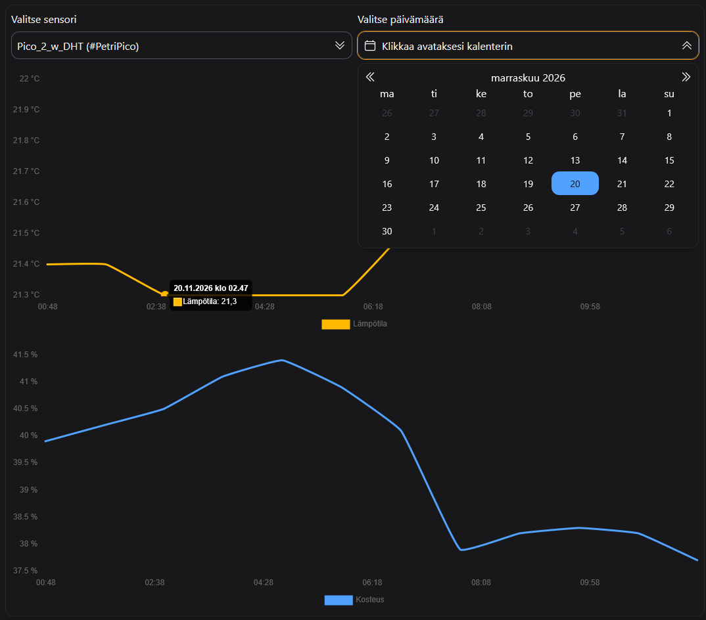

# AT00BY06 IoT:in ja sulautettujen järjestelmien soveltaminen -

- noa/backend sisältää AWS Serverlessiin toteutetun tietokannan koodit
- noa/frontend sisältää käyttöliittymän koodit

#### Ryhmäläisten toteuttamat koodit löytyvät omista kansiostaan (etunimi)

Käyttöliittymä saatavilla https://at00by06-frontend.vercel.app/

